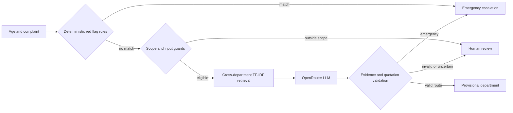

# Product Documentation

## Persona

The intended user is a walk-in reception or triage staff member who needs a provisional destination from a short patient complaint while retaining authority to review or override the system.

## User need

Colloquial complaints do not always map cleanly to hospital departments. The prototype first protects against obvious emergency routing errors, then supplies a traceable department suggestion when evidence is adequate.

## Input

- Adult age from 18 to 120
- English presenting complaint available at reception

The input should describe current symptoms. The system is not designed for complete medical charts, diagnosis requests, procedure scheduling or real patient identifiers.

## Output

| Action | Meaning |
|---|---|
| `EMERGENCY_ESCALATION` | A red flag or model safety decision requires urgent staff action |
| `ROUTE_DEPARTMENT` | Provisional suggestion for one of four supported departments |
| `HUMAN_REVIEW` | Input is outside scope, ambiguous, unsupported or fails validation |

## Architecture

External intelligence is supplied by `openai/gpt-4.1-mini` through OpenRouter. Retrieval and deterministic guards run locally.

## Rule and model boundary

Red-flag rules execute before retrieval and the model. They cannot be overridden by a later model response. The model receives the complaint, age and retrieved weak examples, but not the reference label. A route is accepted only after validating the action, department, cited evidence IDs and exact complaint quotations.

## Target and observed metrics

| Metric | Target | Version 2 development regression |
|---|---:|---:|
| Routine department accuracy | at least 88% | 99.17% |
| Overall human-review rate | at most 12% | 6.67% |
| Dangerous misses | report separately; minimise | 0/20 |
| False emergency escalations | report separately; minimise | 0/130 |
| Rule-first emergency coverage | deterministic red flags before model | 18/20 |

The observations use an inspected development regression set and are not an independent estimate of generalisation.

## Rough edges and future path

- Add deterministic coverage for transient focal weakness and transient slurred speech.
- Improve gait-initiation handling without case-specific lookup.
- Obtain independently reviewed labels and a new frozen test set.
- Add balanced evidence for underrepresented departments.
- Assess privacy, security, monitoring, accountability and applicable Singapore requirements before any real deployment.
